  <a href="https://gorobeyko.com/en/">
     Borys Gorobeyko, Cloud &amp; DevOps Engineer" />
  </a>

  
  
  
  

**IT Cloud Engineer · Cloud & DevOps**

I design, automate and operate infrastructure for financial institutions: banks and brokerages. Day to day that means AWS, Kubernetes with Flux GitOps, Terraform and CI/CD.

## Toolbox

  
  
  
  
  
  
  
  
   
  
  
  
  
  
  
   
  
  
  
  
  
  
  

## Credentials

<table>
  <tr>
    <td align="center" width="50%">
      
       
      <b>B.Sc. Computer Science</b>
       
      Coburg University of Applied Sciences and Arts
    </td>
    <td align="center" width="50%">
      
       
      <b>Linux Foundation Certified IT Associate</b>
       
      LFCA · The Linux Foundation
    </td>
  </tr>
</table>

## Research and Speeches

**Gazing into the Past: An Immersive Gallery of Historical Images via Camera-Guided Video Diffusion and Gaussian Splats** 
Paper and speech · R. Kobets, B. Gorobeyko, J. Grubert · GI VR/AR Workshop, TU Chemnitz · 2025 · [doi:10.18420/VRAR2025_17](https://doi.org/10.18420/VRAR2025_17)

**A review of the artificial intelligence application as a guideline tool for the wound management** 
Paper · Emergency Medicine 20(5) · 2024 · [doi:10.22141/2224-0586.20.5.2024.1742](https://doi.org/10.22141/2224-0586.20.5.2024.1742)

**Application of artificial intelligence in civil and military medicine** 
Paper · Georgian Medical News 348 · 2024 · [PMID 38807400](https://pubmed.ncbi.nlm.nih.gov/38807400/)

## GitHub activity

Metrics and contributions

 

<picture>
  <source media="(prefers-color-scheme: dark)" srcset="https://raw.githubusercontent.com/efedleikudl/efedleikudl/output/snake-dark.svg" />
  
</picture>

Open to collaboration and interesting infrastructure problems. The fastest way to reach me is <a href="mailto:bgorobejko@gmail.com">email</a>.
